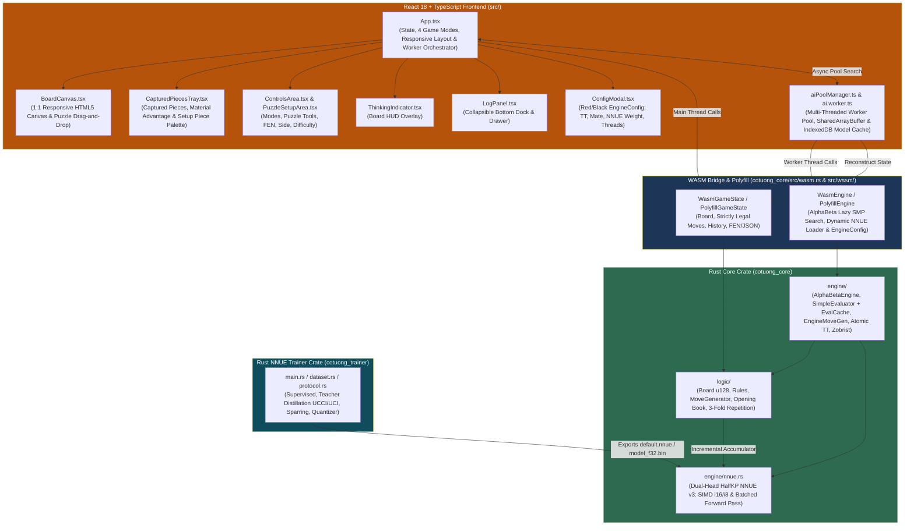
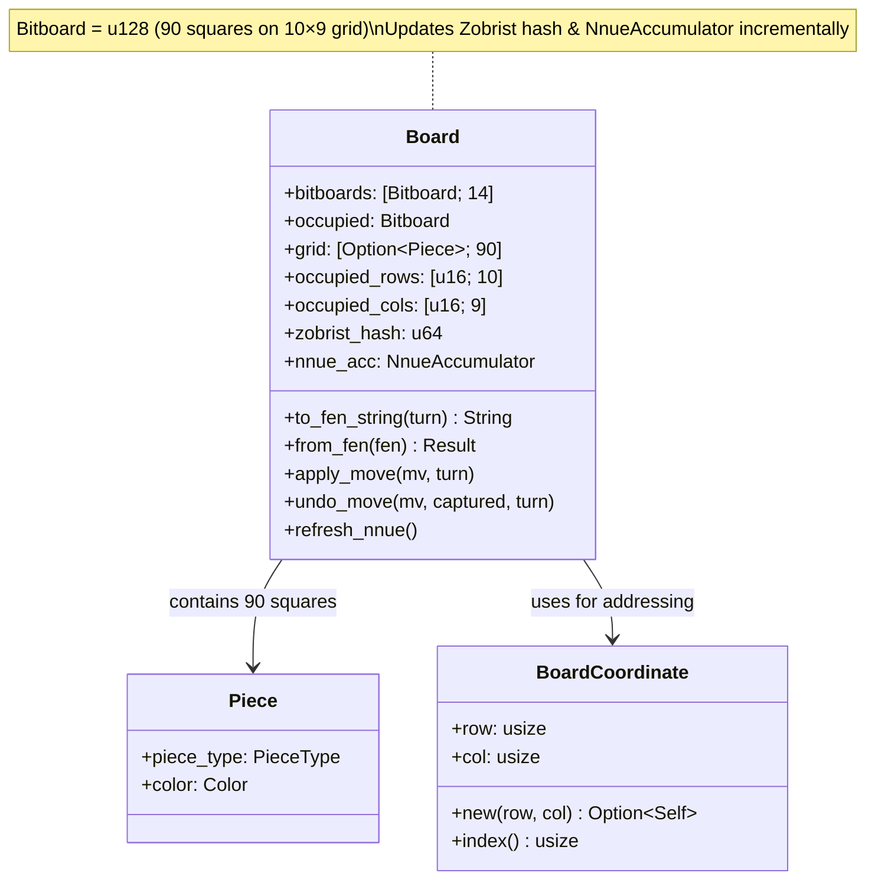
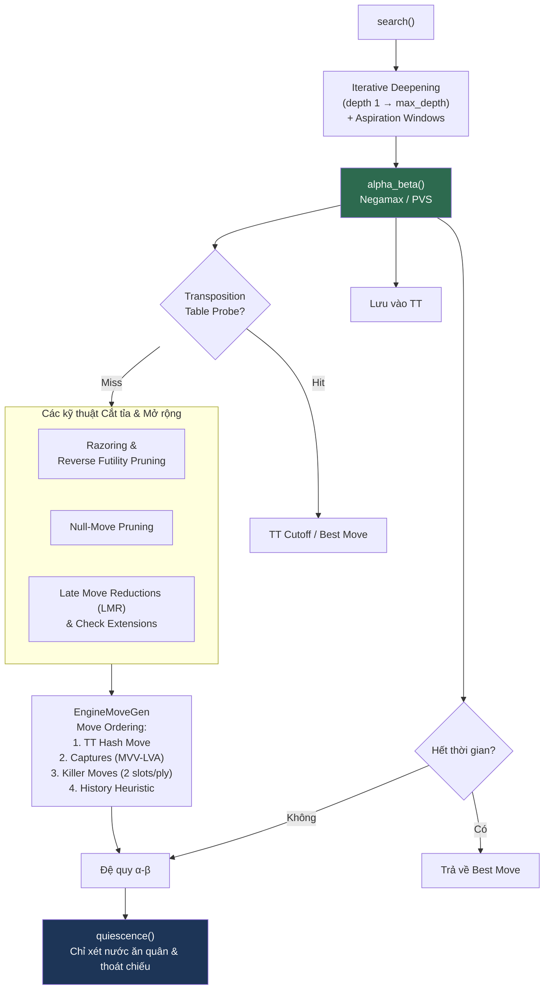
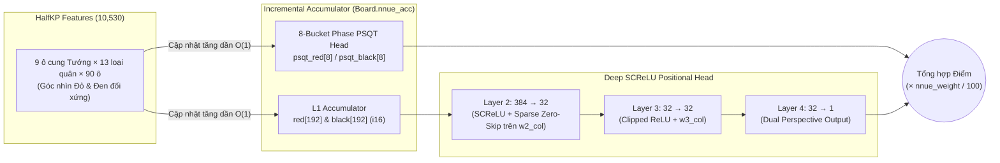
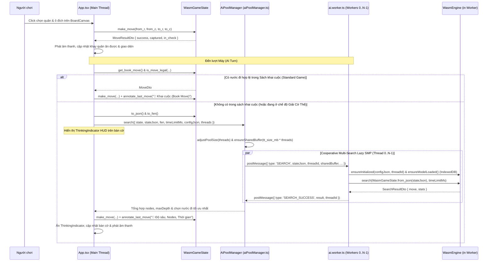

# Cờ Tướng Đại Sư (GameCoTuong) – Architecture Overview

> Ứng dụng Cờ Tướng (Xiangqi / Chinese Chess) tích hợp AI chuyên sâu chạy trên trình duyệt, kết hợp **Rust + WebAssembly (`wasm-bindgen`)** với mạng nơ-ron **Dual-Head HalfKP NNUE v3** cho Core Engine, công cụ huấn luyện **Rust (`cotuong_trainer`)**, và **React 18 + TypeScript + Tailwind CSS v4 + Vite** cho giao diện người dùng.



---

## 1. Cấu trúc Dự án (Repository Structure)

```
GameCoTuong/
├── Cargo.toml                  # Rust Workspace root (members: cotuong_core, cotuong_trainer)
├── package.json                # Scripts (dev, build, lint, test, build:wasm, train, deploy)
├── vite.config.ts              # Cấu hình Vite + React + Tailwind CSS v4
├── wrangler.jsonc              # Cấu hình triển khai Cloudflare Workers / Assets
├── index.html                  # Entry HTML + PWA Service Worker registration
├── test_all.sh                 # Script kiểm thử toàn diện (Rust fmt, clippy, test + Vite build)
├── train.sh                    # Pipeline tự động huấn luyện & lượng tử hóa mạng NNUE
├── train_ai.ipynb              # Notebook huấn luyện AI trên Google Colab
├── cotuong_core/               # Crate Rust trung tâm (Game Logic + AI Engine + NNUE + WASM)
│   ├── Cargo.toml              # Feature `embed-model` (mặc định cho native; tắt khi build WASM nhẹ)
│   ├── assets/                 # Trọng số NNUE cho native/trainer: default.nnue (~4.0MB), model_f32.bin (~8.1MB)
│   ├── fuzz/                   # Cấu hình cargo-fuzz (fuzz_fen, fuzz_json, fuzz_uci)
│   ├── src/
│   │   ├── lib.rs              # Re-exports: engine, logic, wasm (cfg wasm32)
│   │   ├── wasm.rs             # #[wasm_bindgen] exports: WasmGameState, WasmEngine
│   │   ├── engine/             # Bộ tìm kiếm AI Alpha-Beta (Lazy SMP) & Mạng nơ-ron HalfKP NNUE v3
│   │   └── logic/              # Biểu diễn bàn cờ Bitboard u128, luật Cờ Tướng, khai cuộc
│   └── tests/
│       ├── mate_solving.rs     # Bộ test giải cờ thế / chiếu bí
│       ├── property_tests.rs   # Kiểm thử bất biến (Property-based testing: FEN, Zobrist, NNUE, Undo)
│       ├── fuzz_tests.rs       # Kiểm thử Fuzzing & dữ liệu biên chống panic
│       └── profiling_bench.rs  # Đo lường hiệu năng chuyên sâu (Profiling & NPS Benchmarks)
├── cotuong_trainer/            # Crate Rust huấn luyện mạng nơ-ron NNUE
│   ├── Cargo.toml
│   ├── data/                   # Dữ liệu kỳ phổ mẫu (curated_master_games.txt, sample_master_games.txt)
│   └── src/
│       ├── main.rs             # FloatNnue, huấn luyện giám sát, chưng cất, đấu tập & xuất model
│       ├── dataset.rs          # Đọc kỳ phổ, trích xuất đặc trưng HalfKP
│       └── protocol.rs         # Giao tiếp UCCI/UCI với engine ngoài (Pikafish, Fairy-Stockfish)
├── src/                        # Giao diện React 18 + TypeScript
│   ├── main.tsx                # Điểm khởi chạy React DOM
│   ├── App.tsx                 # Component điều phối chính (4 chế độ chơi, bố cục thích ứng, Worker Pool)
│   ├── App.css                 # Tailwind CSS v4 & custom animations
│   ├── components/
│   │   ├── BoardCanvas.tsx     # Bàn cờ HTML5 Canvas 1:1, hỗ trợ kéo-thả xếp cờ thế & xoay chiều
│   │   ├── CapturedPiecesTray.tsx # Khay quân đã ăn, ưu thế điểm & kho quân kéo-thả ở chế độ Cờ Thế
│   │   ├── ControlsArea.tsx    # Thanh chọn chế độ, công cụ cờ thế, cầm quân, độ khó & tác vụ
│   │   ├── PuzzleSetupArea.tsx # Khu vực thiết lập thế cờ, kiểm tra hợp lệ & nạp FEN/thế cờ mẫu
│   │   ├── ThinkingIndicator.tsx # HUD hiển thị tiến trình suy nghĩ của AI trên bàn cờ
│   │   ├── LogPanel.tsx        # Thanh biên bản thu gọn ở đáy & ngăn kéo trượt (Drawer)
│   │   └── ConfigModal.tsx     # Cửa sổ tinh chỉnh EngineConfig (TT, Mate, NNUE Weight, Đa luồng)
│   ├── workers/
│   │   ├── aiPoolManager.ts    # Điều phối Web Worker Pool đa luồng, SharedArrayBuffer & Lazy SMP
│   │   └── ai.worker.ts        # Web Worker chạy tìm kiếm AI bất đồng bộ & nạp NNUE động
│   ├── types/
│   │   ├── game.ts             # Định nghĩa kiểu TypeScript & DEFAULT_ENGINE_CONFIG
│   │   └── config.test.ts      # Unit tests kiểm tra cấu hình EngineConfig & tính toán bộ nhớ TT
│   ├── utils/
│   │   ├── capturedPieces.ts   # Trích xuất quân ăn được, tính ưu thế & kích thước bàn cờ tối ưu
│   │   ├── capturedPieces.test.ts
│   │   ├── fen.ts              # Phân tích/xuất FEN, kiểm tra thế cờ hợp lệ & kho CLASSIC_PUZZLES
│   │   ├── fen.test.ts
│   │   ├── modelStorage.ts     # Quản lý tải và lưu đệm (IndexedDB cache) mô hình `/assets/default.nnue`
│   │   ├── sound.ts            # Quản lý hiệu ứng âm thanh (move, capture, check, checkmate)
│   │   └── export.ts           # Xuất biên bản CSV & cấu hình JSON
│   └── wasm/
│       ├── cotuong_core.ts     # Module xuất WasmGameState & WasmEngine
│       ├── enginePolyfill.ts   # Bản cài đặt Polyfill TypeScript tương thích 100% API WASM
│       └── enginePolyfill.test.ts
└── public/                     # Tài nguyên tĩnh (assets/default.nnue, _headers COOP/COEP, PWA manifest, sw.js, sounds/*.mp3)
```

Workspace-level lints trong `Cargo.toml` **deny** toàn bộ `warnings`, `clippy::all`, `clippy::pedantic`, `clippy::nursery`, `clippy::unwrap_used`, `clippy::expect_used`, và `clippy::indexing_slicing`.

---

## 2. `cotuong_core` – AI Engine, HalfKP NNUE, Game Logic & WASM Bridge

Crate Rust độc lập chứa toàn bộ luật chơi Cờ Tướng, thuật toán tìm kiếm AI, mạng nơ-ron lượng giá NNUE và cầu nối `wasm-bindgen`. Được biên dịch sang cả native (`rlib` phục vụ unit tests, benchmarks & `cotuong_trainer`) và WebAssembly (`cdylib` phục vụ trình duyệt).

### 2.1. Sơ đồ Module (`cotuong_core/src/`)

```
cotuong_core/src/
├── lib.rs                      # Khai báo module: engine, logic, wasm
├── wasm.rs                     # WasmGameState, WasmEngine (serde-wasm-bindgen DTOs)
├── engine/
│   ├── mod.rs                  # Traits: Evaluator, Searcher; Structs: Move, SearchLimit, SearchStats
│   ├── config.rs               # EngineConfig (mate_score, tt_size_mb, nnue_weight, threads)
│   ├── search.rs               # AlphaBetaEngine – Negamax + PVS + Iterative Deepening + Lazy SMP
│   ├── eval.rs                 # SimpleEvaluator & EvalCache – Lượng giá thế cờ bằng mạng HalfKP NNUE v3
│   ├── nnue.rs                 # NnueWeights, NnueAccumulator, Dual-Head HalfKP SIMD & Batched forward pass
│   ├── movegen.rs              # EngineMoveGen – Sinh nước đi kèm chấm điểm sắp xếp (Move Ordering)
│   ├── tt.rs                   # TranspositionTable – Bảng băm Atomic lockless lưu trữ thế cờ đã duyệt
│   ├── zobrist.rs              # ZobristKeys – Mã băm thế cờ 64-bit (XorShift64 RNG)
│   ├── move_list.rs            # MoveList – Danh sách nước đi cấp phát trên stack [Move; 128]
│   ├── bench_test.rs           # Đo hiệu năng NPS (Nodes Per Second)
│   ├── mate_test.rs            # Kiểm thử phát hiện chiếu bí
│   └── search_test_snippet.rs  # Các kịch bản kiểm thử tìm kiếm chuyên biệt
└── logic/
    ├── mod.rs
    ├── board.rs                # Board, Piece, Color, PieceType, BoardCoordinate, Bitboard (u128)
    ├── game.rs                 # GameState – Quản lý lượt đi, lịch sử, hoàn tác (undo), lặp nước 3 lần
    ├── generator.rs            # MoveGenerator – Sinh nước đi hợp lệ dựa trên AttackTables
    ├── rules.rs                # Kiểm tra luật di chuyển, tự chiếu, lộ mặt tướng (Flying General)
    ├── lookup.rs               # AttackTables – Bảng tra cứu nước đi tính sẵn (OnceLock)
    ├── eval_constants.rs       # Hằng số giá trị quân cờ & bảng điểm vị trí (PST)
    ├── opening.rs              # Sách khai cuộc (Opening Book) tra cứu theo chuỗi FEN
    └── repetition_test.rs      # Kiểm thử luật lặp nước và trường chiếu
```

### 2.2. Biểu diễn Bàn cờ (`logic/board.rs`)



| Thành phần | Chi tiết cài đặt |
|---|---|
| Lưới bàn cờ | 10 hàng × 9 cột = 90 giao điểm (`grid: [Option<Piece>; 90]` truy xuất $O(1)$) |
| Bitboard | `u128` (`bitboards: [Bitboard; 14]`, `occupied: Bitboard`) – mỗi bit đại diện cho 1 ô (`row * 9 + col`) |
| Bitmask Hàng/Cột | `occupied_rows: [u16; 10]` và `occupied_cols: [u16; 9]` giúp tra bảng `AttackTables` cho Xe/Pháo tức thì |
| Zobrist Hash | `zobrist_hash: u64` – cập nhật tăng dần (incremental) trong `apply_move` / `undo_move` |
| Bộ tích lũy NNUE | `nnue_acc: NnueAccumulator` – cập nhật tăng dần lớp đầu vào HalfKP (`red`, `black`, `psqt_red`, `psqt_black`) khi quân di chuyển; tự động `refresh_red` / `refresh_black` khi Tướng di chuyển trong cung |
| Chuẩn FEN | Hỗ trợ xuất/nhập trạng thái bàn cờ theo chuẩn Xiangqi FEN |

### 2.3. Kiến trúc AI Engine (`AlphaBetaEngine`)



### 2.4. Mạng Nơ-ron Lượng giá (`engine/nnue.rs` & `engine/eval.rs`)

`SimpleEvaluator` sử dụng kiến trúc **Pikafish-style Dual-Head HalfKP NNUE v3**:



- **Mô Hình Trọng Số NNUE Chuẩn SIMD (`default.nnue`) & Cơ chế Nạp Động qua IndexedDB**:
  - `default.nnue` (magic `XNNU` v3, dung lượng ~4.0 MB): Trọng số lượng tử hóa số nguyên chuẩn SIMD (Feature Transformer $W_1$ là `i16`, các tầng FC $W_2, W_3$ là `i8`, $W_4$ là `i16`).
  - Toàn bộ pipeline forward pass chạy thuần túy số nguyên (integer arithmetic) kết hợp `EvalCache`, không phát sinh bất kỳ phép tính số thực (float) nào trong vòng lặp tìm kiếm Alpha-Beta.
  - **Trong bản Native (`embed-model` feature)**: Trọng số được nhúng trực tiếp và khởi tạo lười một lần qua `OnceLock<NnueWeights>` (`NNUE_INSTANCE`).
  - **Trong bản WebAssembly (`--no-default-features`)**: File `.wasm` được tách nhẹ (~335 KB) giúp khởi tạo Web Worker tức thì; trọng số `/assets/default.nnue` được tải một lần duy nhất, lưu đệm cục bộ vào **IndexedDB** (`src/utils/modelStorage.ts`) và truyền vào từng Worker qua `WasmEngine::load_weights_bytes()`.

### 2.5. Cầu nối WebAssembly & Polyfill (`cotuong_core/src/wasm.rs` & `src/wasm/`)

Module `wasm.rs` đóng gói logic Rust thành 2 lớp xuất qua `#[wasm_bindgen]` (đồng thời có bản tương đương trong `src/wasm/enginePolyfill.ts` khi chạy môi trường JS thuần):

1. **`WasmGameState`**:
   - Khởi tạo & trao đổi dữ liệu: `new()`, `from_fen(fen)`, `to_fen()`, `to_json()`, `from_json(json_str)`.
   - Truy vấn bàn cờ & luật: `get_board()`, `turn()`, `status()`, `is_in_check()`, `get_legal_moves(row, col)`, `is_move_legal(from_r, from_c, to_r, to_c)`, `get_strictly_legal_moves_flat()`.
   - Thực thi & lịch sử: `make_move(from_r, from_c, to_r, to_c)`, `undo_move()`, `get_history()`, `history_len()`, `annotate_last_move(note)`, `get_book_move()`.
2. **`WasmEngine`**:
   - Khởi tạo và quản lý cấu hình/bộ nhớ: `new(config_json)`, `update_config(config_json)`, `clear_tt()`, `load_weights_bytes(bytes)`, `is_nnue_active()`.
   - Đa luồng & Tìm kiếm AI: `set_thread_id(thread_id)`, `thread_id()`, `search(game_state, time_limit_ms, max_depth)`, `search_with_partition(game_state, time_limit_ms, max_depth, allowed_moves_flat)`.

---

## 3. `cotuong_trainer` – Hệ thống Huấn luyện & Chưng cất Mạng NNUE

Crate `cotuong_trainer` cung cấp công cụ dòng lệnh tốc độ cao (sử dụng đa luồng `rayon`) để huấn luyện và xuất các biến thể mạng NNUE:

| Chế độ (`--mode`) | Chức năng |
|---|---|
| `dataset` | Huấn luyện có giám sát (Supervised Learning) trên kho kỳ phổ đại kiện tướng (`curated_master_games.txt`, `sample_master_games.txt`) với lan truyền ngược (Backpropagation) qua cả 2 nhánh Đỏ/Đen |
| `teacher` | Chưng cất tri thức (Teacher Knowledge Distillation) bằng cách giao tiếp qua giao thức **UCCI / UCI** (`protocol.rs`) với các Engine mạnh như **Pikafish** hoặc **Fairy-Stockfish** |
| `sparring` | Tổ chức các trận đấu tập đối kháng tự động giữa mạng NNUE hiện tại với Engine đối thủ để đánh giá tỷ lệ thắng thực chiến |
| `quantize` | Lượng tử hóa mô hình Float32 (`.f32`) sang Mô Hình NNUE Chuẩn (`default.nnue`) chuẩn SIMD (đồng thời lưu vào cả `cotuong_core/assets/default.nnue` và `public/assets/default.nnue`) cùng bản sao lưu `model_f32.bin` |

---

## 4. Giao diện React + TypeScript (`src/`)

### 4.1. Luồng tương tác giữa UI, WASM và Multi-Threaded Worker Pool



### 4.2. Thiết kế các Component & Tiện ích chính

| Component / Module | Vai trò & Đặc điểm kỹ thuật |
|---|---|
| `BoardCanvas.tsx` | Bàn cờ Canvas luôn giữ tỉ lệ vuông **1:1**, tự động xoay 180° khi người chơi chọn cầm quân Đen, hiển thị con trỏ hình quân cờ khi đang chọn quân, hỗ trợ kéo-thả (Drag & Drop) và click chuột phải để xóa quân trong chế độ Xếp Cờ Thế. |
| `CapturedPiecesTray.tsx` | Hiển thị danh sách quân đối phương đã bị ăn kèm số lượng, tổng điểm ăn được và huy hiệu ưu thế vật chất (`+ điểm`). Tự động chuyển đổi giữa thanh dọc hai bên bàn cờ (`sides`) và thanh ngang trên/dưới (`stacked`). Khi ở giai đoạn Xếp Cờ Thế (`setup`), khay này hiển thị số quân còn lại bên ngoài bàn cờ để người dùng kéo-thả hoặc nhấp đặt lên bàn. |
| `ControlsArea.tsx` & `PuzzleSetupArea.tsx` | Quản lý 4 chế độ chơi (`Người đấu với Máy`, `Máy đấu với Máy`, `Hai người chơi`, `Giải Cờ Thế`), chọn thế cờ mẫu (`CLASSIC_PUZZLES`), kiểm tra hợp lệ thế cờ (`validateBoardSetup`), hộp thoại Nhập/Xuất FEN, chọn bên đi tiên và độ khó AI. |
| `ThinkingIndicator.tsx` | Hiển thị lớp phủ HUD trực tiếp ở trung tâm bàn cờ khi AI đang tính toán: đồng hồ đếm thời gian thực, thanh tiến trình, cấp độ khó và thông số độ sâu / số nút duyệt. |
| `LogPanel.tsx` | Thanh biên bản thu gọn ở dưới bàn cờ; khi nhấn vào sẽ mở ngăn kéo trượt (Slide-Up Drawer) hiển thị chi tiết từng hiệp đấu, quân bị ăn, thống kê AI và nút xuất CSV. |
| `ConfigModal.tsx` | Cho phép tinh chỉnh độc lập hoặc đồng bộ cấu hình `EngineConfig` cho **AI Đỏ** và **AI Đen** (`tt_size_mb` mỗi luồng, `mate_score`, `nnue_weight`, `threads` đa luồng), áp dụng nhanh các Preset lọc tự động theo phần cứng thiết bị, và chỉ tái cấp phát bộ nhớ khi nhấn **"Áp Dụng & Đóng"**. |
| `AiPoolManager` & `modelStorage.ts` | Quản lý nhóm Web Worker đa luồng (`1–16` luồng), cấp phát phân vùng `SharedArrayBuffer` cho từng Worker, tự động hồi sinh (respawn) Worker nếu gặp lỗi, và lưu đệm trọng số `/assets/default.nnue` trong IndexedDB. |

---

## 5. Quy trình Build, Huấn luyện & Kiểm thử

| Tác vụ | Lệnh thực thi | Ghi chú |
|---|---|---|
| Chạy Dev Server | `npm run dev` | Khởi chạy Vite dev server tại cổng `3000` (kèm headers COOP/COEP cho `SharedArrayBuffer`) |
| Biên dịch lại WASM | `npm run build:wasm` | Build `cotuong_core` (`--release --no-default-features`) và xuất bindings ra `src/wasm/` |
| Chạy Test Frontend | `npm test` | Chạy bộ unit tests TypeScript (`tsx --test src/**/*.test.ts`) |
| Kiểm tra TypeScript | `npm run lint` | Chạy `tsc --noEmit` |
| Build Production | `npm run build` | Kiểm tra TypeScript và đóng gói ứng dụng vào `dist/` |
| Chạy Test Rust | `cargo test --workspace` | Chạy toàn bộ unit tests, mate-solving, property-based tests và fuzz tests |
| Huấn luyện AI NNUE | `npm run train` | Chạy script `./train.sh` huấn luyện và lượng tử hóa mạng NNUE |
| Kiểm thử Toàn diện | `./test_all.sh` | Chạy lần lượt `cargo fmt --check`, `cargo clippy` (native & wasm32), `cargo test --workspace`, và `npm run build` |
