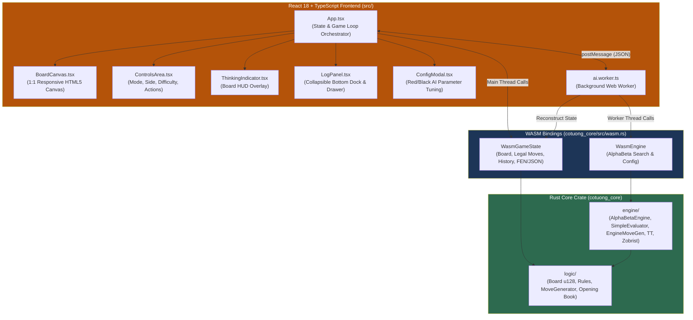
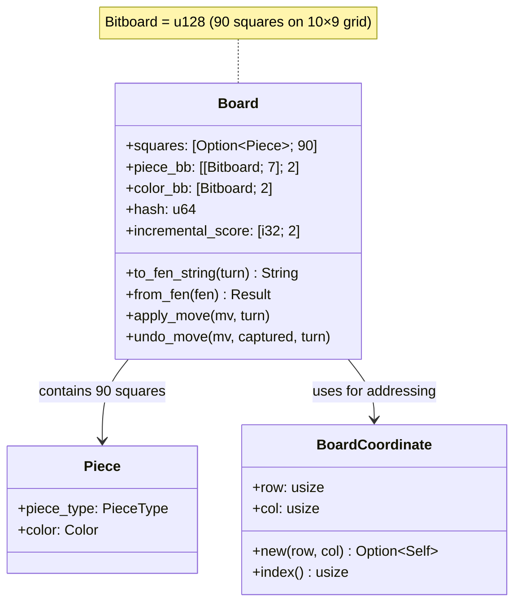
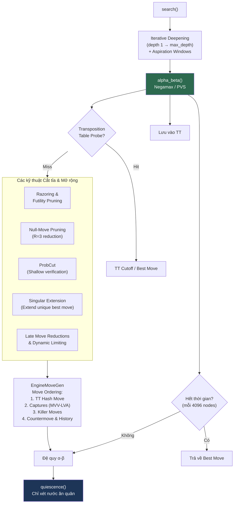
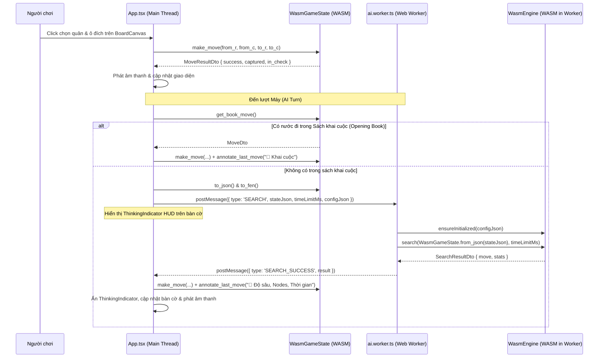

# Cờ Tướng Đại Sư (GameCoTuong) – Architecture Overview

> Ứng dụng Cờ Tướng (Xiangqi / Chinese Chess) tích hợp AI chuyên sâu chạy trên trình duyệt, kết hợp **Rust + WebAssembly (`wasm-bindgen`)** cho Core Engine và **React 18 + TypeScript + Tailwind CSS v4 + Vite** cho giao diện người dùng.



---

## 1. Cấu trúc Dự án (Repository Structure)

```
GameCoTuong/
├── Cargo.toml                  # Rust Workspace root – clippy pedantic/nursery, LTO fat release
├── package.json                # Node/Vite scripts & React/Tailwind dependencies
├── vite.config.ts              # Cấu hình Vite + React + Tailwind CSS v4
├── index.html                  # Entry HTML + PWA Service Worker registration
├── test_all.sh                 # Script kiểm thử toàn diện (Rust fmt, clippy, test + Vite build)
├── cotuong_core/               # Crate Rust trung tâm (Game Logic + AI Engine + WASM bindings)
│   ├── Cargo.toml
│   ├── src/
│   │   ├── lib.rs              # Re-exports: engine, logic, wasm (cfg wasm32)
│   │   ├── wasm.rs             # #[wasm_bindgen] exports: WasmGameState, WasmEngine
│   │   ├── engine/             # Bộ tìm kiếm AI Alpha-Beta & Hàm lượng giá
│   │   └── logic/              # Biểu diễn bàn cờ Bitboard u128, luật Cờ Tướng, khai cuộc
│   └── tests/
│       └── mate_solving.rs     # Bộ test giải cờ thế / chiếu bí
├── src/                        # Giao diện React 18 + TypeScript
│   ├── main.tsx                # Điểm khởi chạy React DOM
│   ├── App.tsx                 # Component điều phối chính (WASM state, Game modes, Worker)
│   ├── App.css                 # Tailwind CSS v4 & custom animations
│   ├── components/
│   │   ├── BoardCanvas.tsx     # Bàn cờ HTML5 Canvas tỉ lệ 1:1 tự động co giãn & xoay chiều
│   │   ├── ControlsArea.tsx    # Thanh chọn chế độ, cầm quân, độ khó & công cụ
│   │   ├── ThinkingIndicator.tsx # HUD hiển thị tiến trình suy nghĩ của AI trên bàn cờ
│   │   ├── LogPanel.tsx        # Thanh biên bản thu gọn ở đáy & ngăn kéo trượt (Drawer)
│   │   └── ConfigModal.tsx     # Cửa sổ tinh chỉnh tham số AI riêng cho Đỏ / Đen
│   ├── workers/
│   │   └── ai.worker.ts        # Web Worker chạy tìm kiếm AI bất đồng bộ
│   ├── types/
│   │   └── game.ts             # Định nghĩa kiểu TypeScript & DEFAULT_ENGINE_CONFIG
│   ├── utils/
│   │   ├── sound.ts            # Quản lý hiệu ứng âm thanh (move, capture, check, checkmate)
│   │   └── export.ts           # Xuất biên bản CSV & cấu hình JSON
│   └── wasm/                   # Mã glue JS/TS và binary .wasm sinh từ wasm-bindgen
└── public/                     # Tài nguyên tĩnh (PWA manifest, sw.js, icon.png, sounds/*.mp3)
```

Workspace-level lints trong `Cargo.toml` **deny** toàn bộ `warnings`, `clippy::all`, `clippy::pedantic`, `clippy::nursery`, `clippy::unwrap_used`, `clippy::expect_used`, và `clippy::indexing_slicing`.

---

## 2. `cotuong_core` – AI Engine, Game Logic & WASM Bridge

Crate Rust độc lập chứa toàn bộ luật chơi Cờ Tướng, thuật toán tìm kiếm AI và cầu nối `wasm-bindgen`. Được biên dịch sang cả native (`rlib` phục vụ unit tests & benchmarks) và WebAssembly (`cdylib` phục vụ trình duyệt).

### 2.1. Sơ đồ Module (`cotuong_core/src/`)

```
cotuong_core/src/
├── lib.rs                      # Khai báo module: engine, logic, wasm
├── wasm.rs                     # WasmGameState, WasmEngine (serde-wasm-bindgen DTOs)
├── engine/
│   ├── mod.rs                  # Traits: Evaluator, Searcher; Structs: Move, SearchLimit, SearchStats
│   ├── config.rs               # EngineConfig – Cấu hình tham số AI (hỗ trợ JSON & scaling)
│   ├── search.rs               # AlphaBetaEngine – Negamax + PVS + Iterative Deepening
│   ├── eval.rs                 # SimpleEvaluator – Đánh giá thế cờ (Material, PST, Mobility, Safety)
│   ├── movegen.rs              # EngineMoveGen – Sinh nước đi kèm chấm điểm sắp xếp (Move Ordering)
│   ├── tt.rs                   # TranspositionTable – Bảng băm lưu trữ thế cờ đã duyệt
│   ├── zobrist.rs              # ZobristKeys – Mã băm thế cờ 64-bit (XorShift64 RNG)
│   ├── move_list.rs            # MoveList – Danh sách nước đi cấp phát trên stack [Move; 128]
│   ├── bench_test.rs           # Đo hiệu năng NPS (Nodes Per Second)
│   ├── mate_test.rs            # Kiểm thử phát hiện chiếu bí
│   └── search_test_snippet.rs  # Các kịch bản kiểm thử tìm kiếm chuyên biệt
└── logic/
    ├── mod.rs
    ├── board.rs                # Board, Piece, Color, PieceType, BoardCoordinate, Bitboard (u128)
    ├── game.rs                 # GameState – Quản lý lượt đi, lịch sử, hoàn tác (undo), lặp nước
    ├── generator.rs            # MoveGenerator – Sinh nước đi hợp lệ dựa trên AttackTables
    ├── rules.rs                # Kiểm tra luật di chuyển, tự chiếu, lộ mặt tướng (Flying General)
    ├── lookup.rs               # AttackTables – Bảng tra cứu nước đi tính sẵn (OnceLock)
    ├── eval_constants.rs       # Giá trị quân cờ, bảng điểm vị trí (PST), trọng số lượng giá
    ├── opening.rs              # Sách khai cuộc (Opening Book) tra cứu theo chuỗi FEN
    └── repetition_test.rs      # Kiểm thử luật lặp nước và chiếu trường
```

### 2.2. Biểu diễn Bàn cờ (`logic/board.rs`)



| Thành phần | Chi tiết cài đặt |
|---|---|
| Lưới bàn cờ | 10 hàng × 9 cột = 90 giao điểm |
| Mảng ô cờ | `[Option<Piece>; 90]` giúp truy xuất quân cờ tại tọa độ bất kỳ trong $O(1)$ |
| Bitboard | `u128` – mỗi bit đại diện cho 1 ô (`row * 9 + col`), tối ưu hóa phép toán bit cho việc tìm quân và kiểm tra chiếu |
| Zobrist Hash | `u64` – cập nhật tăng dần (incremental) trong `apply_move` / `undo_move` |
| Điểm lượng giá | `incremental_score: [i32; 2]` (Đỏ/Đen) – cập nhật tăng dần cho Material + PST |
| Chuẩn FEN | Hỗ trợ xuất/nhập trạng thái bàn cờ theo chuẩn Xiangqi FEN |

### 2.3. Kiến trúc AI Engine (`AlphaBetaEngine`)



| Kỹ thuật | Mô tả chi tiết |
|---|---|
| Tìm kiếm chính | Negamax kết hợp Alpha-Beta Pruning, Principal Variation Search (PVS) & Iterative Deepening |
| Aspiration Windows | Thu hẹp cửa sổ tìm kiếm quanh điểm số của độ sâu trước để tăng tốc độ cắt tỉa |
| Sắp xếp nước đi | TT Hash Move → Ăn quân (MVV-LVA) → Killer Moves (2 slot/ply) → Countermove → History Heuristic |
| Null-Move Pruning | Giảm độ sâu $R=3$ khi không bị chiếu để phát hiện nhanh các nhánh vượt ngưỡng $\beta$ |
| ProbCut | Cắt tỉa thống kê dựa trên kết quả tìm kiếm nông |
| Late Move Reductions | Bảng giảm độ sâu tính sẵn `[[u8; 64]; 64]` cho các nước đi đứng cuối danh sách |
| Singular Extension | Mở rộng thêm độ sâu nếu nước đi từ TT tốt vượt trội so với mọi nước đi thay thế |
| Quiescence Search | Chỉ duyệt các chuỗi ăn quân ở nút lá nhằm loại bỏ hiệu ứng đường chân trời (Horizon Effect) |
| Transposition Table | Bảng băm kích thước lũy thừa của 2, chiến lược thay thế ưu tiên độ sâu |
| Quản lý thời gian | Hỗ trợ giới hạn theo `Depth(u8)` hoặc `Time(u64)` ms (kiểm tra đồng hồ mỗi 4096 nodes) |
| Sách khai cuộc | Tra cứu nhanh các biến khai cuộc kinh điển theo FEN (`logic/opening.rs`) trước khi gọi Engine |

### 2.4. Hàm Lượng giá (`SimpleEvaluator`)

| Thành phần | Mô tả |
|---|---|
| Giá trị quân (Material) | Mặc định: Tướng = 6000, Xe = 600, Pháo = 285, Mã = 270, Tượng = 120, Sĩ = 120, Tốt = 30 (có thể tùy chỉnh riêng cho Đỏ/Đen qua `EngineConfig`) |
| Bảng vị trí (PST) | Piece-Square Tables `[[i32; 9]; 10]` cho từng loại quân, tự động lật đối xứng cho quân Đen |
| Độ cơ động (Mobility) | Đếm số nước đi hợp lệ của Xe, Mã, Pháo, Tốt (có giới hạn trần) |
| An toàn Tướng | Phạt nặng khi Tướng bị lộ mặt hoặc bị Pháo đối phương nhắm tới trên cùng cột/hàng (0 hoặc 1 ngòi) |
| Cấu trúc phòng thủ | Thưởng điểm khi cặp Sĩ hoặc cặp Tượng liên kết bảo vệ lẫn nhau |
| Quân treo (Hanging) | Phạt điểm khi quân ta bị đối phương tấn công mà không có quân bảo vệ |

### 2.5. Cầu nối WebAssembly (`cotuong_core/src/wasm.rs`)

Module `wasm.rs` đóng gói logic Rust thành 2 lớp xuất qua `#[wasm_bindgen]`:

1. **`WasmGameState`**:
   - Quản lý trạng thái ván đấu trên luồng chính (UI): `new()`, `from_fen()`, `to_fen()`, `to_json()`, `from_json()`.
   - Truy vấn bàn cờ & luật: `get_board()`, `turn()`, `status()`, `is_in_check()`, `get_legal_moves(row, col)`.
   - Thực thi & lịch sử: `make_move(from_r, from_c, to_r, to_c)`, `undo_move()`, `get_history()`, `annotate_last_move(note)`, `get_book_move()`.
2. **`WasmEngine`**:
   - Khởi tạo và chạy tìm kiếm AI bên trong Web Worker: `new(config_json)`, `update_config(config_json)`, `search(game_state, time_limit_ms, max_depth)`.

---

## 3. Giao diện React + TypeScript (`src/`)

### 3.1. Công nghệ Frontend

| Tầng | Công nghệ |
|---|---|
| UI Framework | React 18 (Functional Components + Hooks) + TypeScript 5 |
| Build Tool | Vite 5 |
| Styling | Tailwind CSS v4 (Phong cách gỗ trầm & sơn mài cổ điển: `#14110F`, `#1C1815`, `#F5EFE6`) |
| Icons | `lucide-react` |
| Bàn cờ | HTML5 Canvas 2D (`BoardCanvas.tsx`), hỗ trợ màn hình Retina/HiDPI (`devicePixelRatio`) |
| Đa luồng | Web Worker chuẩn ES Module (`src/workers/ai.worker.ts`) |
| PWA | `manifest.json` + Service Worker (`public/sw.js`) hỗ trợ cài đặt & chơi offline |

### 3.2. Luồng tương tác giữa UI, WASM và Web Worker



### 3.3. Thiết kế các Component chính

| Component | Vai trò & Đặc điểm kỹ thuật |
|---|---|
| `BoardCanvas.tsx` | Bàn cờ Canvas luôn giữ tỉ lệ vuông **1:1** (`Math.max(200, Math.min(window.innerWidth, window.innerHeight))`), tự động xoay bàn cờ 180° khi người chơi chọn cầm quân Đen, vẽ chữ Hán truyền thống (`帥`/`將`, `楚 河`/`漢 界`), dấu thập vị trí Pháo/Tốt, vòng tròn ngọc bích báo nước đi hợp lệ và vòng đỏ báo nước bắt quân. |
| `ControlsArea.tsx` | Chọn 1 trong 3 chế độ chơi (`Người đấu với Máy`, `Máy đấu với Máy`, `Hai người chơi`), chọn bên cầm quân (`Đỏ` / `Đen`), chọn 5 cấp độ khó (`1s` → `20s`), cùng các nút `Ván mới`, `Đi lại`, `Tạm dừng/Bắt đầu` (CvC), `Biên bản`, `Xuất CSV`, và `Cấu hình AI`. |
| `ThinkingIndicator.tsx` | Hiển thị lớp phủ HUD trực tiếp ở trung tâm bàn cờ khi AI đang tính toán: đồng hồ đếm thời gian thực, thanh tiến trình, cấp độ khó và thông số độ sâu / số nút duyệt (`k nodes`). |
| `LogPanel.tsx` | Thiết kế dạng thanh thu gọn ở dưới bàn cờ (*"ẩn xuống, khi nào cần thì mở lên xem"*). Khi nhấn vào sẽ mở ngăn kéo trượt (Slide-Up Drawer) hiển thị chi tiết từng hiệp đấu, quân bị ăn, thống kê AI và nút xuất CSV. |
| `ConfigModal.tsx` | Cho phép tinh chỉnh độc lập cấu hình `EngineConfig` cho **AI Đỏ** và **AI Đen** (giá trị 7 loại quân, trọng số Hash/Capture/Killer/History, phương pháp cắt tỉa Dynamic/LMR, Mate Score) cũng như Nhập/Xuất file JSON. |

---

## 4. Quy trình Build & Kiểm thử

| Tác vụ | Lệnh thực thi | Ghi chú |
|---|---|---|
| Chạy Dev Server | `npm run dev` | Khởi chạy Vite dev server tại cổng `3000` |
| Biên dịch lại WASM | `npm run build:wasm` | Build `cotuong_core` (`--release`) và xuất bindings ra `src/wasm/` |
| Kiểm tra TypeScript | `npm run lint` | Chạy `tsc --noEmit` |
| Build Production | `npm run build` | Kiểm tra TypeScript và đóng gói ứng dụng vào `dist/` |
| Chạy Test Rust | `cargo test --workspace` | Chạy toàn bộ unit tests và bài test giải cờ thế |
| Kiểm thử Toàn diện | `./test_all.sh` | Chạy lần lượt `cargo fmt --check`, `cargo clippy` (native & wasm32), `cargo test`, và `npm run build` |

---

## 5. Các Quyết định Thiết kế Trọng tâm

1. **Kiến trúc Hybrid Rust/WASM + React**: Tận dụng tốc độ tính toán cấp máy trạm và kiểm soát bộ nhớ chặt chẽ của Rust cho AI Engine (`cotuong_core`), đồng thời phát huy hệ sinh thái UI hiện đại, linh hoạt của React 18 + Tailwind CSS v4.
2. **Tách biệt Luồng Tính toán qua Web Worker**: `WasmEngine` chạy hoàn toàn trong `ai.worker.ts`, đảm bảo giao diện React và đồng hồ đếm thời gian trên `ThinkingIndicator` luôn mượt mà ở 60fps ngay cả khi AI duyệt hàng triệu nút ở Cấp 5 (20 giây).
3. **Truyền Trạng thái Đầy đủ qua JSON (`stateJson`)**: Khi gửi yêu cầu tìm kiếm sang Web Worker, toàn bộ `GameState` (bao gồm lịch sử băm thế cờ `position_history`) được serialize sang JSON giúp AI phát hiện chính xác lỗi lặp nước / trường chiếu trong quá trình tìm kiếm.
4. **Bitboard `u128` & Bảng Tra cứu Tĩnh (`OnceLock`)**: Toàn bộ 90 giao điểm của bàn cờ 10×9 nằm gọn trong một thanh ghi `u128`; kết hợp cùng `AttackTables` và `ZobristKeys` khởi tạo một lần duy nhất giúp tối đa hóa số nút duyệt mỗi giây (NPS).
5. **Zero Heap Allocation trong Vòng lặp Tìm kiếm**: Sử dụng `MoveList` (`[Move; 128]`) trên stack và cập nhật điểm/hash tăng dần (`incremental_score`, `hash`) ngay khi đi/hoàn tác nước cờ.
6. **Bàn cờ Canvas 1:1 Thích ứng (Responsive Square Canvas)**: Tự động tính toán kích thước theo cạnh nhỏ hơn của màn hình (`Math.min(window.innerWidth, window.innerHeight)`), kết hợp lớp phủ HUD thông tin trực quan và biên bản dạng ngăn kéo thu gọn giúp tối ưu không gian hiển thị trên cả máy tính lẫn điện thoại.
